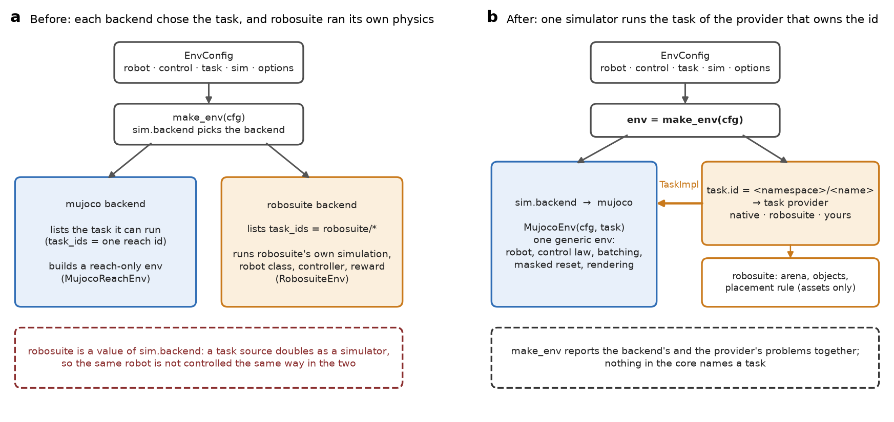

# robotdesigner documentation

`robotdesigner` describes robot embodiments as validated, hashable data and runs them in batched TorchRL environments on
several simulators, so the same task can be given to many embodiments and every run traces back to one hash.

Start with the [README](../README.md) for installation and a first environment.

## Reference

| page | covers |
|---|---|
| [RobotConfig](configs/robot.md) | `ParametricArm` and its parts, the `chain()` generator, the kinematics oracle, the robot hash |
| [ControlConfig](configs/control.md) | control modes, `FixedGains`, `InertiaScaledGains`, the action scale |
| [TaskConfig](configs/task.md) | the params object that is the task, its providers, target regions, how to add a provider |
| [SimConfig and simulator options](configs/sim.md) | simulator, batch size, time step, seed, scene, `MujocoOptions` |
| [EnvConfig](configs/env.md) | how the sections combine, serialization, hashing, errors |
| [Simulators](simulators.md) | simulators, capabilities, the environment contract, how an environment is put together, adding a simulator |
| [robosuite scenes](tasks/robosuite.md) | robosuite arenas and objects as a task, objectives, which environments work |
| [Writing a task provider](tasks/writing-a-provider.md) | a new task source end to end: params class, provider object, registration, engine side, tests |
| [Recording and showing videos](viz.md) | `env.render()`, `robotdesigner.viz` clips, the frame recorder and camera framing |
| [Design spec](spec_robotconfig_env.md) | why it is built this way, status and decisions |

Every Python example in the configuration and task pages is executed by the test suite (`tests/test_docs.py`), so they match the code.

## How the pieces fit



```
EnvConfig
├── robot            RobotConfig (ParametricArm)   what the body is
├── control          ControlConfig                 how an action drives the joints
├── task             TaskConfig                    what to do; the params object of a task provider is the task
└── sim              SimConfig                     which simulator and its options, batch size, time step, seed, scene

env = make_env(cfg)
        simulator = sim.simulator                    capabilities + validate
        task      = provider of task.params         validate + build   (all problems reported at once)
        -> TorchRL EnvBase
```

- **The robot is data.** It is frozen, validated and serializable, and its hash ignores labels and float noise.
- **Nothing has a hidden default.** Everything that changes behaviour is a field, and `env_hash` covers all of it.
- **The task is independent of the embodiment**, so one task config can be paired with arms of any size.
- **Simulators and tasks are separate.** `sim.simulator` names a physics engine; tasks (and the scenes and objects they
  bring) come from task providers. Neither knows the other's list: nothing in the core names a task.
- **Simulators refuse instead of approximating.** An unsupported combination is rejected before anything is built.
- **One environment contract** for every simulator and task: batched, no autoreset, masked reset, injected state,
  nested observations.

Conventions: SI units, angles in radians, quaternions `(w, x, y, z)`, task observations of positions in the robot's base
frame.

## Words used in these docs

| word | meaning |
|---|---|
| **embodiment** | a robot as data: a `ParametricArm` (joints and links in kinematic order, a base pose). A study varies the embodiment and holds the task fixed |
| **simulator** | the physics engine named by `sim.simulator` (`mujoco`; later MuJoCo Warp), realized as code in `robotdesigner.simulators`. It steps the robot and whatever the task adds. It is never a source of tasks |
| **options** | the settings of one simulator, `sim.options` (`MujocoOptions` for `mujoco`) |
| **task** | what the robot is asked to do: a provider's params object (it names the provider and the task) with a horizon (`TaskConfig`); `task.id` is the derived `<namespace>/<name>`. It never mentions the number of joints |
| **task provider** | the owner of a namespace: it names its tasks, checks a config against a simulator and builds the task. `robosuite` is the one in the package; yours register by namespace ([writing one](tasks/writing-a-provider.md)) |
| **objective** | in the robosuite provider, the rule for success and reward on a scene object (`LiftObject`, `ReachObject`) |
| **scene** | two things: `sim.scene` is a preset of the simulator (`empty`, `plain_floor`); a robosuite scene is the arena and objects a task adds to it |
| **config side, engine side** | the numpy-only classes (configs, params classes, provider objects) and the code that needs torch and the simulator's library; "engine" means those libraries |
| **`robot_hash`, `env_hash`** | 12-character identifiers of the robot and of the whole environment config; the robot's label is in neither |

## Recipe: one task, a family of arms

Hold the task, the control and the sim fixed and vary the embodiment. Each configuration gets its own hash, and the
robot hash tells the arms apart.

```python
from dataclasses import replace

from robotdesigner.config import (
    ControlConfig, EnvConfig, FixedGains, MujocoOptions, Pose, SimConfig, TaskConfig, chain,
)
from robotdesigner.tasks.robosuite import LiftObject, RobosuiteParams   # a task comes from the provider that owns it

MOUNT = Pose((-0.56, 0.0, 0.912), (1.0, 0.0, 0.0, 0.0))   # where robosuite mounts a stock arm in the Lift scene

def arm_with(n):
    # the same total length and mass, spread over n joints: a yaw joint followed by n - 1 pitch joints
    return chain(n, "z" + "y" * (n - 1), total_length=0.9, total_mass=3.0, radius=0.03, damping=0.5,
                 armature=0.01, frictionloss=0.0, effort_limit=50.0, range=(-2.5, 2.5), base_pose=MOUNT,
                 label=f"{n}-joint")

base = EnvConfig(
    robot=arm_with(3),
    control=ControlConfig("joint_pos_abs", FixedGains(kp=60.0, kd=6.0), action_scale=None),
    task=TaskConfig(params=RobosuiteParams("Lift", {}, LiftObject("cube", height=0.84), reset_noise=0.0,
                                           terminate_on_success=False),   # the same table and cube for every arm
                    horizon=200, success_tolerance=None, target_region=None),
    sim=SimConfig("mujoco", num_envs=8, device="cpu", dt=0.002, integrator="euler", control_freq=50.0, seed=0,
                  scene="empty", options=MujocoOptions(self_collision=False)),
)
family = {n: replace(base, robot=arm_with(n)) for n in (2, 3, 4, 5, 6)}

assert len({cfg.env_hash for cfg in family.values()}) == 5               # five different environments
assert len({cfg.robot.config_hash for cfg in family.values()}) == 5      # five different robots
assert all(cfg.task == base.task and cfg.sim == base.sim for cfg in family.values())   # one task, one sim
```

Then build each with `env = make_env(cfg)` (the robosuite extra is needed to build the scene). With the same `sim.seed`
and `num_envs` every arm gets the same cube placement at every reset, whatever its number of joints: the task draws from
its own random stream. The hashes in `cfg.env_hash` and `env.env_hash` identify each run.
